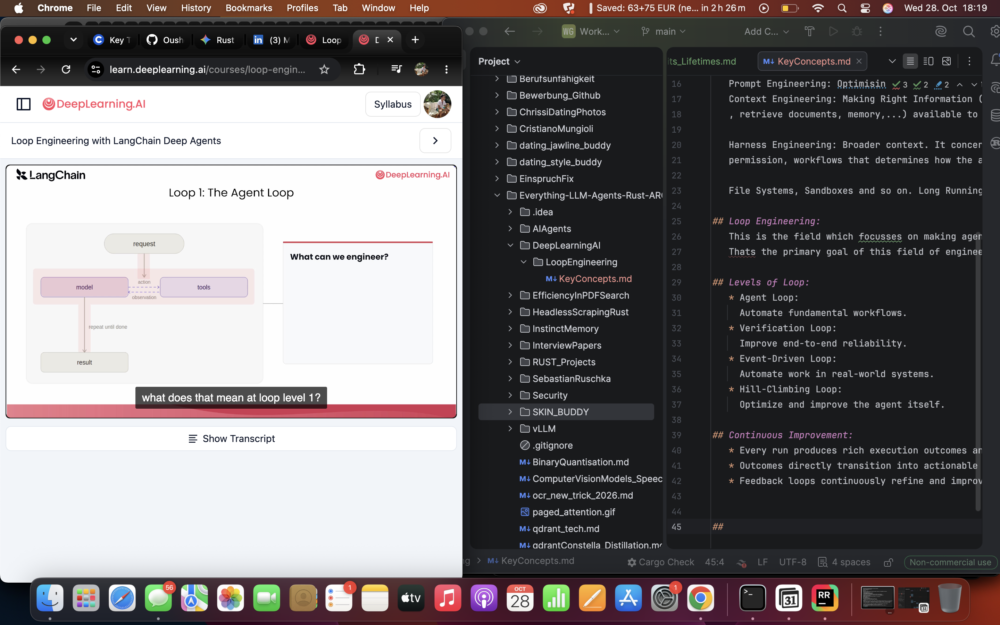
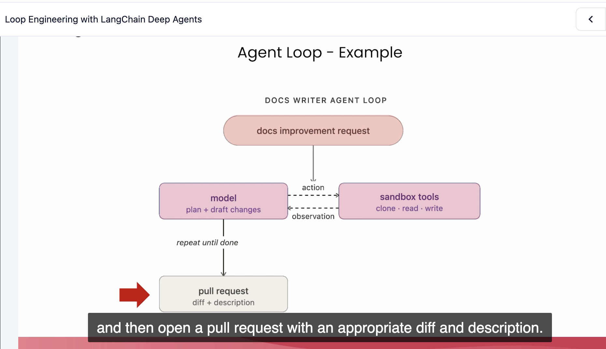
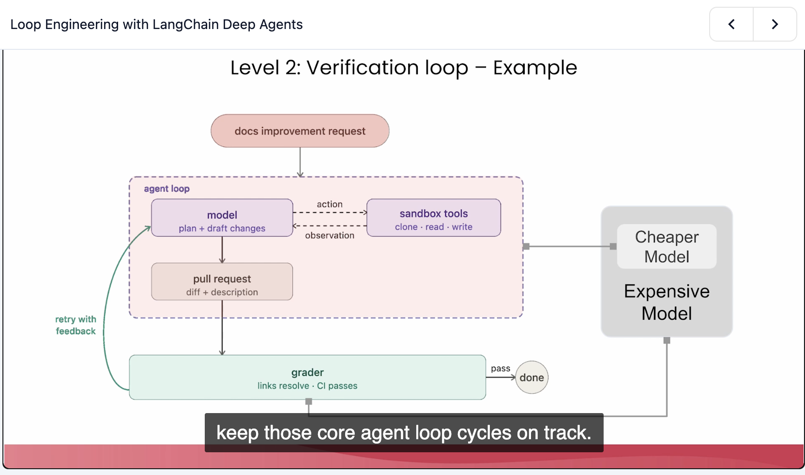
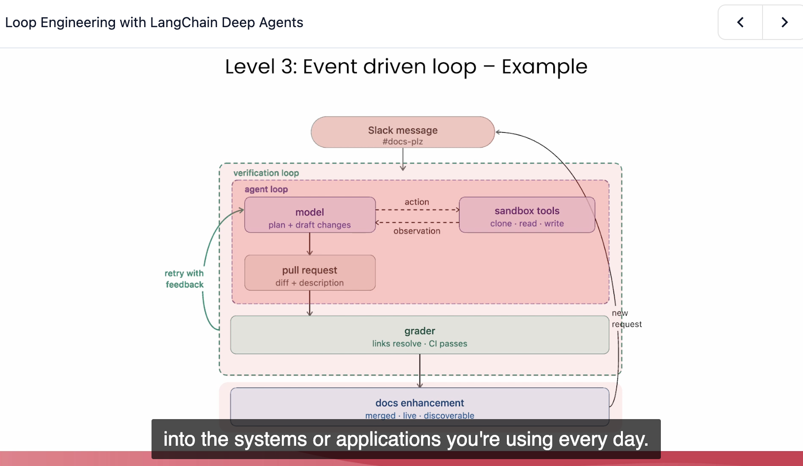
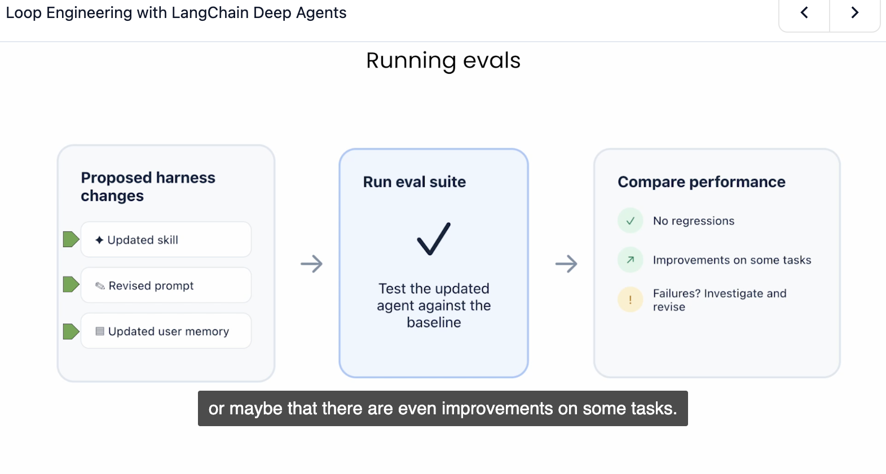

## Key Concepts: 
 

## Loop Engineering: 
   4 Ways to Engineer Loops
   Loop Engineering in the field of AI Agent Engineering

   Event  Driven Engineering:
   

## Diving it into different Concepts:
   
   We see details and move outwards:
   Part of it is: Prompt Engineering and on top Context Engineering
   
   Prompt Engineering: Optimising Instructions sent to the model
   Context Engineering: Making Right Information (tool descriptiosn and results
   , retrieve documents, memory,...) available to the LLM at the right time.
   
   Harness Engineering: Broader context. It concerns the system surrounding the model.  Tools, middleware,
   permission, workflows that determines how the agent operates.

   File Systems, Sandboxes and so on. Long Running Agents --> 

## Loop Engineering: 
   This is the field which focusses on making agents improve over time.
   Thats the primary goal of this field of engineering.

## Levels of Loop:
   * Agent Loop: 
     Automate fundamental workflows.
   * Verification Loop: 
     Improve end-to-end reliability.
   * Event-Driven Loop: 
     Automate work in real-world systems.
   * Hill-Climbing Loop:
     Optimize and improve the agent itself.

## Continuous Improvement: 
   * Every run produces rich execution outcomes and traces
   * Outcomes directly transition into actionable feedback
   * Feedback loops continuously refine and improve future behavior.

## Loop1: The Agent Loop
   
   
   What can one engineer here: The Agent Loop.
   
   1. Choose the Right Model that fits the instruction for a resaonble cost.
      This entails you choose a cheaper and faster model for simple tasks like maybe JEV
      parallel systems model and maybe more expensive models for reasoning like
      O-Family models from OpenAI. Models slower but giving Chain of Thought and Reasoning.

   2. Tool Selection and Tool Provisioning: 
      Selection of Tools with different capabilities
      How does the Agent choose better? Usually each has a 
      description. So the key here is to have better description
      writing so the agent can choose there wisely.
   3. Tool Description Level: Optimize definitions

## Example Loop: Agent Loop: 
   
   
   Example is a docs writer Agent Loop:
   
   Model -> Input: Instruction or Prompt (Task: Plan+ Draft changes)
         -> action --> Sandbox --> Tools 

## Level 2: Verification Loop.
   So you need an agent that grades the output or decision of another gradient
   How do you implement that? 
   
   So here we have a new system:
   -- Grader grades (links resolve- CI passes)
   

## Loop3: Event Driven Loop
   Here the event it the new request: 
   If the request works, then the loop continues.

   

## Loop4: Hill Climbing (Self Improvement Loop)
   

## Running Evals: 
   Running Evals: 
   
   Proposed Changes: 
   
   Pipeline of the Running Eval End to End:
   