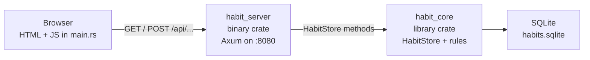

## Layout

Cargo workspace: a library crate plus a binary crate.

```
MinimalRustHabitTracker/
├── readme.md
├── setup.md
└── habit-app/                         workspace root
    ├── Cargo.toml                     members: habit_core, habit_server
    ├── habits.sqlite                  created at runtime, next to the process cwd
    └── crates/
        ├── habit_core/                library crate
        │   ├── Cargo.toml
        │   └── src/lib.rs             models, SQLite store, streak rules
        └── habit_server/              binary crate
            ├── Cargo.toml
            └── src/main.rs            Axum routes and the HTML/JS page
```

The page is not a separate crate. `habit_server` returns it from `render_app`.

## How the crates connect



| Crate | Cargo kind | Job |
|---|---|---|
| `habit_core` | library, `src/lib.rs` | Domain and persistence. `Habit`, `LogStatus`, `HabitStore`, streak and heatmap math. |
| `habit_server` | binary, `src/main.rs` | HTTP adapter. Builds the Axum router, binds `127.0.0.1:8080`, and calls `habit_core`. Also serves the UI. |

The workspace `Cargo.toml` only lists members. `habit_server` depends on `habit_core` with a path dependency. A browser calls `/api/today`, `/api/habits`, `/api/habits/{id}/status`, or `/api/statistics`. The handler in `main.rs` calls `HabitStore`, which reads and writes SQLite. `GET /` returns the page that then calls those routes.

## Phase 1 (WebApp): 
   Use Axum in habit_server
   

## Phase 2 ():